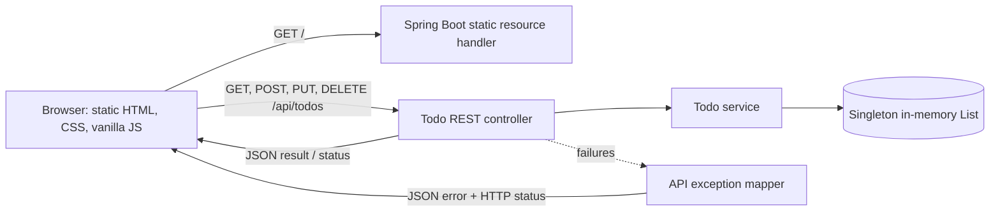

# Architecture

- Status: APPROVED
- Requirements: `requirements.md` (approved 2026-11-12)
- Story source: Jira issue CB-1, Capstone board, TODO-001 (`TO-DO APP`)
- Approval record: User approved the architecture and requested Spring Boot 4.x on 2026-11-12: "use some 4.x.x version thn, and yeah till now approved". Spring Boot 4.1.2 was selected as the current stable compatible release based on official documentation.

## Context and quality attributes

This is a single-process TODO application served at `http://localhost:8080`. A browser loads a static page from the Spring Boot application and uses same-origin REST requests to manage one shared task list. The list is held in server memory: it is shared by all clients handled by that process, survives page refreshes, and is lost when the process restarts. No account or per-user isolation is part of the approved scope.

The design prioritizes simple, predictable CRUD behavior, atomic task mutations under concurrent requests, clear validation feedback, and a mobile-friendly static interface. Persistence, login, priorities, due dates, multiple lists, and deployment work are explicitly out of scope.

## Technology choices

| Concern | Choice/version | Rationale | Alternatives |
| --- | --- | --- | --- |
| Language/runtime | Java 17 baseline | Java 17 is the approved minimum and the minimum required by Spring Boot 4.1.2. The actual installed JDK will be checked during implementation preflight. | A later JDK is acceptable if supported by the selected Spring Boot release and available in the implementation environment. |
| Framework | Spring Boot 4.1.2 | The user approved moving from Jira's original 3.x constraint to 4.x. The official 4.1 system requirements specify Java 17 or later; the official project page lists 4.1.2 as the current stable release on 2026-11-12. Its OSS support window is shown through 2027-07. | Upgrade to a later compatible 4.1.x patch if required by security or support guidance before implementation; record the reason and revalidate compatibility. |
| Build | Maven 3.6.3 or later (`pom.xml`) | Explicitly required; Spring Boot 4.1.2 documents Maven 3.6.3 as the minimum supported version. | Gradle is not selected because Maven is required. |
| HTTP/application layer | Spring MVC REST controllers and static resource serving | Provides the required JSON endpoints and serves the static page from the required classpath location using one same-origin application. | A separate frontend server would add infrastructure and cross-origin concerns without meeting the requested simple shape as directly. |
| Frontend | Plain HTML, CSS, and vanilla JavaScript at `src/main/resources/static/index.html` | Explicitly required; no frontend framework or client-side persistence is needed. | A framework or browser `localStorage` is excluded by the approved requirements. |
| Runtime data | Process-local Java `List<Todo>` with synchronized store operations | Satisfies the in-memory `List` requirement while making duplicate checks and updates atomic across request threads. | Database or distributed storage conflicts with the approved scope. |
| Dependencies | Spring Boot web starter and Spring Boot test starter are the expected minimal starting set, subject to the selected Boot version's managed dependencies | Provides MVC/JSON and focused testing without persistence or authentication dependencies. No dependencies are installed or configured in this architecture task. | Avoid adding a database driver, ORM, Spring Security, or frontend build tool for the current scope. |

## Components and responsibilities

| Component | Responsibility | Requirement IDs |
| --- | --- | --- |
| Spring Boot application | Start the embedded HTTP server on port 8080 and wire the application components. | NFR-01, AC-08 |
| Static page | Serve `src/main/resources/static/index.html` at `/`; provide responsive task entry, list, Done controls, delete controls, counters, validation feedback, an error popup/message, and an empty state showing `0 of 0 done` when the list is empty. | FR-01, FR-02, FR-03, FR-04, FR-05, NFR-01, NFR-02; AC-01 through AC-07, AC-09 |
| Todo REST controller | Expose the four required `/api/todos` routes, validate request shape, delegate operations, and return the agreed HTTP statuses and JSON. | FR-02, FR-03, FR-04, FR-06, FR-08, FR-10; AC-02, AC-04, AC-05, AC-07, AC-10, AC-11 |
| Todo service/store | Own the single process-wide list and perform normalized creation, duplicate detection, completion updates, deletion, and defensive reads atomically. | FR-03, FR-04, FR-06, FR-07, FR-08, FR-09, FR-10; AC-04, AC-05, AC-10, AC-11 |
| Todo model and request/response DTOs | Represent task identity, normalized display text, completion state, and JSON boundaries without exposing mutable store state. | FR-02, FR-03, FR-04, FR-06, FR-08, FR-10; AC-02, AC-04, AC-05, AC-07, AC-11 |
| API exception mapper | Convert validation, duplicate, malformed request, and missing-ID failures to consistent JSON error bodies and HTTP statuses. | FR-03, FR-04, FR-08, FR-10; AC-04, AC-05, AC-07, AC-11 |

## Data and request flows

1. The browser requests `/`; Spring Boot serves `index.html` from the classpath static directory.
2. On page load, vanilla JavaScript calls `GET /api/todos`, renders the returned tasks, derives the total and completed counts, and shows the empty state with `0 of 0 done` when the response is empty.
3. On submission, the browser sends task text to `POST /api/todos`. The service trims it, rejects empty text, and checks for a duplicate atomically with insertion. On success, the browser renders the returned task without reloading the document.
4. Done and delete actions send `PUT /api/todos/{id}` and `DELETE /api/todos/{id}` respectively. After success, the browser updates the affected task and counts; on failure it shows the API message in a user-visible popup/message.
5. A page refresh repeats the GET and reconstructs the UI from server memory. It does not write task data to browser storage.

## Interfaces and contracts

All API routes are same-origin JSON endpoints. The exact statuses and response/error representations below are architecture choices accepted by the user with the architecture approval on 2026-11-12; they were not specified in Jira. Suggested representations are deliberately small; no timestamps, categories, or extra task fields are needed by the approved behavior.

| Method and path | Request | Success response | Failure behavior |
| --- | --- | --- | --- |
| `GET /api/todos` | None | `200 OK`, JSON array of `{ "id": "...", "text": "...", "completed": false }`; an empty list is `[]`. | Unexpected server failure maps to `500` with a generic error body; do not expose stack traces. |
| `POST /api/todos` | `{ "text": "  Buy milk  " }` | `201 Created`, JSON task with stored text `"Buy milk"`. | `400 Bad Request` for missing/null/empty/whitespace-only text or malformed input; `409 Conflict` for a duplicate after trimming and case-insensitive comparison. Return a user-displayable message. |
| `PUT /api/todos/{id}` | `{ "completed": true }` or `{ "completed": false }` | `200 OK`, JSON representation of the updated task. Either value is accepted so Done is reversible. | `400 Bad Request` for malformed or missing completion value; `404 Not Found` for an unknown ID. |
| `DELETE /api/todos/{id}` | None | `204 No Content`. | `404 Not Found` for an unknown ID. |

Use a stable error body such as `{ "code": "DUPLICATE_TODO", "message": "A task with this text already exists." }`. Keep error codes stable and messages safe to display. The controller advice maps domain exceptions to `400`, `404`, and `409` consistently. The exact wording is a UI detail; validation and unknown-ID failures must remain user-visible.

The in-memory model contains a generated unique `id`, normalized `text`, and `completed` boolean. UUID strings are a suitable ID representation because IDs need only be unique within the current process lifetime; IDs are not promised to survive restart. The create DTO contains `text`; the update DTO contains `completed`; response DTOs expose only `id`, `text`, and `completed`.

The store is a singleton Spring service containing a private Java `List<Todo>`. Synchronize each complete operation on the store, including the normalized duplicate scan plus insertion, lookup plus update, and lookup plus deletion. Return immutable snapshots/DTOs rather than the mutable backing list. This prevents concurrent requests from creating duplicates or corrupting iteration while retaining one shared list for all clients. Use `Locale.ROOT` for case-insensitive comparison so behavior does not depend on the server's locale. Keep the trimmed original spelling for display; compare a derived normalized key only.

No maximum text length is specified by the approved requirements; do not introduce an arbitrary limit without a requirements decision. The API should reject malformed input and null values explicitly.

## Security, privacy, and failure handling

- Authentication and per-user authorization are intentionally absent. Every client able to reach the application sees and can change the same list, as required by FR-09. Do not add login, sessions, or list ownership.
- The shared list may contain task text visible to every client. Because the service has no identity boundary, exposing it beyond the intended local context would expose and permit modification of all tasks. Network exposure is a known scope risk, not a reason to silently add authentication or separate lists.
- Serve the page and API from the same origin; no CORS configuration is needed for the described browser flow. Do not add a security dependency for the current unauthenticated local application.
- Render user-entered task text as text (for example, DOM `textContent`), not interpolated HTML, to avoid interpreting task text as markup. Display server error messages as text as well.
- Validate at the server boundary even if the browser also blocks empty input. Duplicate checking and insertion must be one synchronized operation.
- Use consistent JSON errors for expected failures. Do not return stack traces or internal exception details. Unexpected failures return a generic `500` response.
- At zero tasks, show an empty-list message and the `0 of 0 done` count; deleting the final task returns the page to this state.
- For mobile verification, exercise a representative narrow viewport and check that task entry, Done/delete controls, messages, and counts remain usable without horizontal page overflow. This is a verification method, not a new numeric requirement.
- There are no credentials or persistent personal records in the approved design. Task data is volatile and disappears on restart; refresh does not clear it.

## Deployment and operations

- Build and run with Maven 3.6.3 or later using Spring Boot 4.1.2; `mvn spring-boot:run` must start the application as required by AC-08.
- Use the default HTTP port `8080`, with the root page reachable at `http://localhost:8080`. Do not add deployment infrastructure, containerization, or external services under this scope.
- Package the static entry page at `src/main/resources/static/index.html` so the same application serves both UI and API.
- The in-memory list is scoped to one running application process. It is not shared across separate instances and is reset on restart. Do not scale to multiple instances or add persistence without changing the approved requirements.
- Keep operational behavior minimal: startup failure should be visible in the process logs; routine API failures should use the HTTP error contract above. Avoid logging submitted task text unnecessarily.

## Architecture decisions

| ID | Decision | Rationale | Consequences |
| --- | --- | --- | --- |
| ADR-01 | Use Java 17 as the baseline with Spring Boot 4.1.2 and Maven 3.6.3 or later. | The user explicitly changed the framework line from Jira's original 3.x requirement to 4.x and approved the architecture. Official Spring Boot 4.1.2 requirements specify Java 17+ and Maven 3.6.3+; the project page lists 4.1.2 as current stable on 2026-11-12. | Check installed Java/Maven versions during preflight. The 4.1.x OSS support window is listed through 2027-07. |
| ADR-02 | Use Maven and serve the plain static frontend from the Spring Boot application at the required classpath path. | These are explicit technology and location constraints; same-origin requests keep the runtime simple. | No separate frontend build/server or CORS setup is required. |
| ADR-03 | Use one singleton service with a private in-memory Java `List<Todo>` and synchronized whole-operation methods. | Meets the shared-list and `List` constraints while making duplicate checks and mutations safe under concurrent requests. | State is shared only inside one process, is lost at restart, and cannot be shared across multiple application instances. |
| ADR-04 | Trim task text before storage and compare trimmed text case-insensitively using `Locale.ROOT`; reject blank and duplicate tasks. | Directly implements FR-08 and FR-10 consistently on the server, independent of browser behavior and server locale. | Duplicate submissions return a conflict response; the stored/displayed spelling is the trimmed submitted spelling. |
| ADR-05 | Model completion as a boolean changed by `PUT`, allowing both `true` and `false`; return `404` for unknown PUT and DELETE IDs. | Implements reversible Done behavior and the user-approved unknown-ID behavior. | The UI must retain and display a useful error when either operation fails. |
| ADR-06 | Use JSON DTOs and centralized exception-to-HTTP mapping; use `201`, `200`, `204`, `400`, `404`, and `409` with the stable `{code,message}` error body specified above. | The user accepted this proposed API contract as part of the architecture approval on 2026-11-12; it is a design decision, not a Jira-specified requirement. | The browser must handle non-2xx responses and show validation/not-found messages. |
| ADR-07 | Derive total and completed counts from the current server response/UI state rather than maintaining a second counter. | Avoids count drift after add, toggle, or deletion and satisfies FR-05. | Each successful mutation must update the rendered list before recomputing the two counts. |
| ADR-08 | Do not add authentication, a database, browser task persistence, or deployment components. | These are explicitly excluded; they would change the approved shared, volatile list behavior. | Any future requirement for isolation, durable data, or network deployment needs a scope change. |
| ADR-09 | Show `0 of 0 done` and a concise empty state when the list has no tasks; verify mobile usability at a representative narrow viewport without horizontal page overflow. | Resolves design-review findings DR-03 and DR-04 without adding a numeric viewport requirement or changing functional scope. | The same empty state is shown initially and after deleting the last task; mobile verification remains qualitative and repeatable. |

## Risks, assumptions, and open questions

| ID | Item | Handling |
| --- | --- | --- |
| R-01 | Spring Boot 4.1.x OSS support is scheduled through 2027-07. | Use the official support calendar and review the current supported patch during implementation preflight; update the pin if necessary and preserve Java/Maven compatibility. |
| R-02 | All clients share the same unauthenticated task list, so any client that can reach the server can read and mutate every task. | This is explicitly approved behavior. Keep the intended localhost context; revisit requirements before exposing the service to other users or networks. |
| R-03 | In-memory state disappears at restart and is not shared between multiple server processes. | This matches the explicit requirement. No durability or multi-instance guarantee is made. |
| R-04 | No maximum task-text length or detailed visual design threshold is specified. | Do not impose an arbitrary length restriction; validate mobile usability against AC-09 during implementation without changing functional scope. |

## Requirement traceability

Story source facts: Jira CB-1 (`TO-DO APP`), Capstone board, Story TODO-001, approved requirements dated 2026-11-12. The tables above use these approved IDs without adding functional scope.

| Requirement/criterion | Architectural coverage |
| --- | --- |
| FR-01; AC-01 | Static page served at `/` from the Boot classpath. |
| FR-02; AC-02, AC-03 | POST create flow, JSON DTO, and client-side update without document reload. |
| FR-03; AC-04 | Reversible boolean completion update, strikethrough rendering, unknown-ID `404`, visible UI error. |
| FR-04; AC-05 | Delete endpoint, unknown-ID `404`, visible UI error. |
| FR-05; AC-06 | Counts derived from list state and recomputed after successful mutations. |
| FR-06; AC-10 | GET endpoint and server-side in-memory Java list. |
| FR-07; AC-10 | Refresh reloads from server; no task persistence in `localStorage`. |
| FR-08; AC-02, AC-07 | Server trims text and rejects empty/whitespace-only submissions with validation feedback. |
| FR-09 | Singleton process-wide shared list; no signup, login, or per-user partition. |
| FR-10; AC-11 | Atomic duplicate detection after trimming, case-insensitive via `Locale.ROOT`, with validation feedback. |
| NFR-01; AC-08 | Java 17+ / Spring Boot 4.1.2 / Maven 3.6.3+, required static path, and Maven startup requirement. |
| NFR-02; AC-09 | Responsive page responsibility; verify usability on desktop and mobile during implementation. |
| NFR-03; AC-10 | Volatile in-memory server data survives refresh and resets on process restart. |

## Approval

- Decision: APPROVED
- User wording: "use some 4.x.x version thn, and yeah till now approved"
- Date: 2026-11-12

The next gate is implementation planning. Before implementation, inspect the installed Java/Maven versions and confirm the current supported Spring Boot 4.1.x patch; do not begin coding until the implementation plan is explicitly approved and repository preflight is complete.