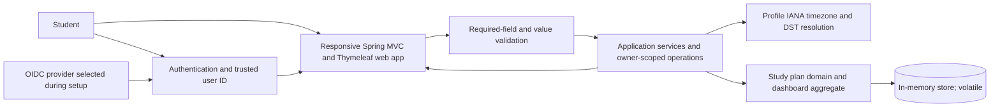

# Architecture

- Status: APPROVED by user on 2026-10-16; approved scope amendment OQ-11 recorded on 2026-10-16. Independent review is being performed.
- Requirements: `requirements.md` (APPROVED 2026-10-16)
- Approval record: Original user approval and the OQ-11 scope amendment are recorded under Approval below.

## Context and quality attributes

The application serves a student who manages study plans, subjects, topics, study sessions, and an aggregate dashboard. The approved scope is recorded in `requirements.md`; no additional product requirements are introduced here. Authentication uses OIDC, with the provider selected during setup, and the student's identity comes from the authenticated user ID (FR-07).

The central security invariant is mandatory owner-scoping on every plan and child-resource read, list, aggregate, and mutation. Unauthenticated requests receive 401. A missing resource and a foreign-owned resource receive the same 404 response; neither existence nor private data is disclosed, and a foreign-owned resource must never produce 403 (FR-07, FR-08; AC-07, AC-08).

The approved quality requirement is a responsive interface for desktop, tablet, and mobile (NFR-01). Standard security and error handling are required (NFR-02). No performance, availability, scale, recovery, retention, or recovery-time targets are specified.

## Technology choices

The choices below distinguish user-decided requirements/proposals from architect recommendations. Recommendations remain subject to architecture approval; this draft itself is not approval.

| Concern | Choice/version | Rationale | Alternatives |
| --- | --- | --- | --- |
| Java | Java 21 is the current environment baseline; retaining it is an architect recommendation awaiting architecture approval. | The prior draft recorded Java 21.0.12 in the environment and treated Java 21 as an LTS choice. Confirm the actual implementation environment before pinning it. | Another supported Java LTS compatible with the selected Spring Boot release and eventual deployment environment. |
| Spring Boot | Spring Boot is required by the approved single Java web application choice. Version 4.1.1 is a tentative architect recommendation, not an approved or latest-version claim. | The prior draft recorded previously checked official compatibility evidence that Spring Boot 4.1.1 supports Java 17+ and is compatible with Java 21. This evidence is carried forward, not independently reverified here; recheck supported versions and dependency compatibility during architecture approval. | A supported Spring Boot release compatible with the approved Java version and selected dependencies. |
| Web stack and application shape | Single Java web application using Spring Boot, Spring MVC, and Thymeleaf; user-decided. Internal modular boundaries are an architect recommendation. | Matches the approved application constraint and keeps the study-planning workflows in one application. The UI must be responsive across desktop, tablet, and mobile. | No alternate client architecture is proposed against the approved constraint. |
| Build | Maven Wrapper is an architect recommendation awaiting architecture approval; no build tool is decided by the requirements. | A wrapper can make the selected Maven version reproducible. The prior draft recorded Maven as not installed and compatibility evidence for Maven 3.6.3+ or Gradle 8.14+/9.x with the then-checked Spring Boot evidence. Revalidate before pinning; no build files are in scope for this artifact update. | Gradle Wrapper with a supported compatible Gradle release. |
| Storage | In-memory storage only; local execution; user-decided by OQ-11. Data is volatile and resets when the application stops. | Meets the explicit local-only scope without requiring a database server. The earlier PostgreSQL proposal is superseded for this implementation. | Durable database storage is not part of this implementation. |
| Configuration | No database credentials or connection settings are required. The OIDC provider is selected during setup; its configuration mechanism is not selected here. | Keeps setup aligned with local execution and the required OIDC authentication without introducing a database or deployment dependency. | Select an appropriate protected mechanism for OIDC configuration during setup; do not infer a deployment target. |
| Identity | OIDC is required; the provider is selected during setup. | Authentication and the authenticated user ID provide the identity boundary (FR-07). No provider is selected by this architecture draft. | Provider choice is deferred to setup. |

Version evidence carried forward from the prior draft is not independently reverified here and does not establish that Spring Boot 4.1.1 is the latest supported release. Confirm supported versions, Java compatibility, and dependency compatibility during architecture approval.

## Components and responsibilities

| Component | Responsibility | Requirement IDs |
| --- | --- | --- |
| Spring MVC + Thymeleaf web layer | Render plan, subject, topic, session, and dashboard views; accept form submissions; support responsive desktop, tablet, and mobile layouts. Bind authenticated identity from the security context, never request-supplied identity. | FR-01–FR-08, NFR-01 |
| OIDC authentication integration | Authenticate students through the OIDC provider selected during setup and expose the authenticated user ID to the application. Reject unauthenticated requests with 401. | FR-07, AC-07 |
| Request validation and error mapping | Reject missing required fields and invalid values; map validation, authentication, and resource outcomes to non-sensitive responses. Preserve identical 404 behavior for missing and foreign-owned resources. | FR-01–FR-03, FR-06–FR-08; AC-01–AC-03, AC-06–AC-08 |
| Application services | Orchestrate plan, subject, topic, session, profile-timezone, and dashboard workflows. Enforce mandatory owner-scoping for every plan and child-resource read, list, aggregate, and mutation. Resolve session local date/time using the student's profile timezone. | FR-01–FR-08; AC-01–AC-08 |
| Domain model and validation | Represent students, profile IANA timezones, plans, subjects, topics/status, and sessions. Enforce required fields, positive numeric duration, allowed topic statuses, and daylight-saving gap/overlap rules. | FR-01–FR-06; AC-01–AC-06 |
| In-memory storage adapter | Hold profile and study data for the lifetime of the running application; provide owner-scoped operations, preserve child-to-parent relationships, and support owner-scoped dashboard aggregates. Data is volatile and resets when the application stops. | FR-01–FR-08; AC-01–AC-08 |
| Operational/error handling | Keep error responses and logs free of credentials, tokens, private study data, and resource-existence signals; expose sanitized unexpected failures. | FR-07, FR-08, NFR-02 |

## Data and request flows

1. The student authenticates using OIDC through the provider selected during setup. The application obtains the authenticated user ID from its trusted security context. Never accept a student/owner ID from a form, route parameter, or client-controlled header (FR-07).
2. A submitted operation is validated before storage. Required values are: plan title and target completion date; subject name; topic title; and session date, start time, and numeric duration greater than zero minutes. Missing required fields and invalid values are rejected. No maximum session duration or other date-range limit is inferred (FR-01–FR-03, FR-06).
3. For each plan or child-resource operation, pass the authenticated user ID into the application and in-memory storage access path. Scope every read, list, aggregate, and mutation by that owner and verify the child-to-parent relationship within the same storage operation. Do not perform an unscoped lookup followed by an authorization decision (FR-07).
4. If a requested resource is absent or belongs to another student, return the same 404 Not Found response with no existence or private-data disclosure. Unauthenticated requests return 401. Never return 403 for a foreign-owned resource (FR-07, FR-08).
5. For a session, read the student's IANA timezone from their profile and resolve the submitted local date/time. Reject nonexistent daylight-saving local times. For ambiguous local times, require an explicit UTC offset and use it to resolve the instant. Past sessions are allowed (FR-03).
6. Store validated changes in memory within the student's owned plan hierarchy. Topic status is limited to Not Started, In Progress, or Completed (FR-04). Data resets when the application stops.
7. Compute dashboard totals in memory across only that student's plans. Round completion percentage to the nearest whole number and return 0% when there are no topics. The aggregate itself must be owner-scoped (FR-05).
8. Keep responses and operational logs free of another student's data, resource-existence signals, credentials, and tokens (FR-07, FR-08, NFR-02).

## Interfaces and contracts

These are capability-level MVC workflows, not finalized route names or form schemas. Student identity is taken only from the authenticated security context. All plan and child-resource reads, lists, aggregates, and mutations must be owner-scoped.

| Capability | Resource relationship | Proposed operations | Requirement trace |
| --- | --- | --- | --- |
| Study plans | Title and target completion date are required; reject missing or invalid values. | Create, read, update, delete, and list the authenticated student's plans only. Missing and foreign-owned plan requests return the same 404. | FR-01, FR-06–FR-08; AC-01, AC-06–AC-08 |
| Subjects | Subject name is required; reject missing or invalid values. | Add, read, list, update, and delete only under a plan owned by the authenticated student. Scope every operation by owner and verify the parent relationship in memory. | FR-02, FR-06–FR-08; AC-02, AC-06–AC-08 |
| Topics and status | Topic title is required. Status must be Not Started, In Progress, or Completed. | Add, read, list, update, delete, and change status only under an owned plan and subject. Scope every operation and verify parent relationships in memory. | FR-02, FR-04, FR-06–FR-08; AC-02, AC-04, AC-06–AC-08 |
| Study sessions | Date, start time, and numeric duration greater than 0 minutes are required. Interpret local time using profile IANA timezone; reject DST gaps and require an explicit UTC offset for overlaps. Past dates/times are valid. | Create, read, list, update, and delete only within the authenticated student's owned plan scope. Apply owner-scoping to every operation. | FR-03, FR-06–FR-08; AC-03, AC-06–AC-08 |
| Student profile timezone | Store an IANA timezone in the student's profile and use it to interpret session date/time. | Read the profile timezone from authenticated student context. No profile editing workflow is added by this architecture. | FR-03 |
| Dashboard | Counts and percentage span all and only the authenticated student's topics; nearest-whole-number rounding and 0% for no topics. | Read an owner-scoped aggregate; do not aggregate across students. | FR-05, FR-07; AC-05, AC-07 |

Unauthenticated requests return 401. Validation errors reject the request; a 400 response is the proposed web-layer mapping, subject to architecture approval. Missing and foreign-owned resources return the same 404, without data or existence disclosure. Never return 403 for a foreign-owned resource. The exact error page/body and route design remain implementation details, not additional requirements. All application data is held in memory and is lost when the application stops.

## Security, privacy, and failure handling

- Require OIDC authentication for student data operations and obtain student identity from the authenticated user ID. Select/configure the provider during setup; do not trust client-provided identity values (FR-07).
- Enforce mandatory owner-scoping on every plan and child-resource read, list, aggregate, and mutation. Verify child-parent ownership in the same in-memory storage operation. This applies to direct child IDs, nested operations, lists, and dashboard aggregation (FR-07).
- Return 401 for unauthenticated requests. Return the same 404 for missing and foreign-owned resources; do not reveal existence or private data. Never return 403 for a foreign-owned resource (FR-07, FR-08).
- Reject missing plan title/target completion date, subject name, topic title, and session date/start time/duration. Reject invalid values, including duration that is non-numeric, zero, or negative. Do not add an unspecified duration maximum (FR-01–FR-03, FR-06).
- Resolve session local date/time with the IANA timezone stored in the student's profile. Reject nonexistent DST local times and require an explicit UTC offset for ambiguous local times. Do not reject past sessions (FR-03).
- Keep OIDC credentials and tokens out of source, responses, and logs, and protect any local OIDC configuration. In-memory storage requires no database credentials or connection settings. No deployed traffic or TLS ingress is part of this local-only implementation.
- Sanitize unexpected errors. Do not place private study data, credentials, tokens, or ownership/existence signals in responses or logs (NFR-02).
- Privacy jurisdiction, retention, encryption-at-rest policy, rate limits, backup objectives, and availability targets are unspecified; do not imply decisions about them.

## Deployment and operations

The approved application shape is a single Java web application using Spring Boot, Spring MVC, and Thymeleaf. Run it locally with in-memory storage only; no database server or deployment is required. Data is volatile and resets when the application stops. The deployment target remains deliberately deferred until the environment is known and is out of scope for this implementation; no hosting target is selected.

Deployment topology, deployment-specific operations, and environment-specific values remain deferred until a deployment environment is known. Configure the OIDC provider during setup and protect its credentials. Maven Wrapper remains a build recommendation awaiting architecture approval; this artifact update does not create build files or install dependencies.

## Testability

Planned verification after implementation approval; these tests have not been run:

- Domain/service and MVC validation tests for each required field: plan title and target completion date, subject name, topic title, session date, start time, and duration. Verify missing values and invalid values are rejected; verify non-numeric, zero, and negative durations are rejected and positive numeric duration is accepted.
- Timezone tests using the student's stored IANA timezone: valid local times resolve correctly; past sessions remain accepted; nonexistent DST local times are rejected; ambiguous DST local times are rejected without an explicit UTC offset and resolve correctly when the offset is supplied.
- Topic status tests for the three allowed values and rejection of unsupported values; dashboard tests for owner-scoped totals, nearest-whole-number rounding, and 0% with no topics.
- Security and in-memory storage integration tests for 401 when unauthenticated and identical 404 responses for missing and foreign-owned resources. Test another student's plan and child IDs on direct read, list, aggregate, update, and delete paths; verify no disclosure, no cross-owner aggregate, and no mutation.
- Verify storage is in memory only and that data resets when the application stops; no database credentials, database connection settings, or deployment setup should be required.

## Architecture decisions

This is the single authoritative architecture decision register. “User-decided” records approved requirements-level decisions; it does not mean the architecture artifact has architecture/design approval. Architect recommendations remain pending that approval.

| ID | Decision | Rationale | Consequences |
| --- | --- | --- | --- |
| ADR-01 | **USER-DECIDED: Same 404 for missing and foreign-owned resources.** | Approved FR-08/AC-08 requires indistinguishable not-found responses without existence or private-data disclosure, alongside authenticated ownership in FR-07/AC-07. | Return 401 when unauthenticated; return the same 404 for absent and foreign-owned resources; never return 403 for a foreign-owned resource. Owner-scope all operations. |
| ADR-02 | **USER-DECIDED: Required fields and invalid-value rejection.** | Approved FR-01–FR-03 and FR-06 enumerate required plan, subject, topic, and session fields. Session duration must be numeric and greater than zero minutes. | Reject missing required fields and invalid values. Do not invent duration upper bounds or date-range limits. |
| ADR-03 | **USER-DECIDED: OIDC identity and timezone/DST behavior.** | Approved FR-03/FR-07 specify OIDC, provider selection during setup, identity from authenticated user ID, an IANA timezone stored in the student profile, gap rejection, explicit offset for overlaps, and acceptance of past sessions. | Use authenticated identity, not client-supplied identity. Resolve session local date/time from the profile timezone; reject nonexistent times and require an explicit UTC offset for ambiguous times. |
| ADR-04 | **USER-DECIDED: In-memory storage only; keep the application local; no database server or deployment.** | OQ-11 was approved by the user on 2026-10-16. This supersedes the earlier PostgreSQL proposal for this implementation. | Store data only in memory; it is volatile and resets when the application stops. No database credentials or connection settings are required. Deployment is not required; the deployment target remains deferred and out of scope. |
| ADR-05 | **USER-DECIDED: Single Java web app using Spring Boot, Spring MVC, and Thymeleaf; responsive across desktop, tablet, and mobile.** | This is the approved application constraint and NFR-01 device coverage. | Design MVC-rendered workflows and responsive templates within one application. Java/Spring versions, build tool, and internal module structure are architect recommendations awaiting architecture approval. |

## Risks, assumptions, and open questions

- No blocking requirements questions remain in the approved requirements. The deployment target is explicitly deferred until the environment is known and is not an implementation blocker.
- The user-approved OQ-11 scope amendment keeps this implementation local and in-memory. Volatile data loss when the application stops is an accepted limitation; no database or deployment is required.
- Independent review is being performed. The architecture status remains APPROVED, including the approved scope amendment recorded on 2026-10-16.
- Java 21, tentative Spring Boot version 4.1.1, Maven Wrapper, and modular internal boundaries are architect recommendations, not approved implementation choices. Recheck official support and dependency compatibility during architecture approval; the recorded compatibility evidence is not a claim that 4.1.1 is the latest supported release.
- The OIDC provider is intentionally selected during setup. No deployment environment or hosting target is selected; deployment remains deferred and out of scope for this implementation.
- No upper session duration, date range, performance target, availability target, or operational recovery objective was specified. Do not infer one.
- Exact routes, form schemas, error-page details, schema/versioning, and operational controls remain design/implementation details. They must preserve the approved contracts above.

## Approval
- Decision: APPROVED
- User wording: "I approve the architecture and design. Proceed with implementation planning only, then stop for my approval before coding."
- Date: 2026-10-16
- Approved scope amendment: On 2026-10-16, the user directed, "dont enforce db or deployment , keep everything local" and selected "In memory only". OQ-11 records in-memory storage only, volatile data that resets when the application stops, and no database server or deployment requirement; the earlier PostgreSQL proposal is superseded for this implementation.